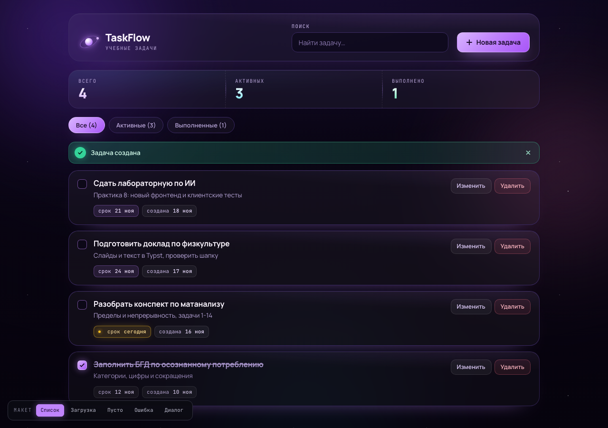
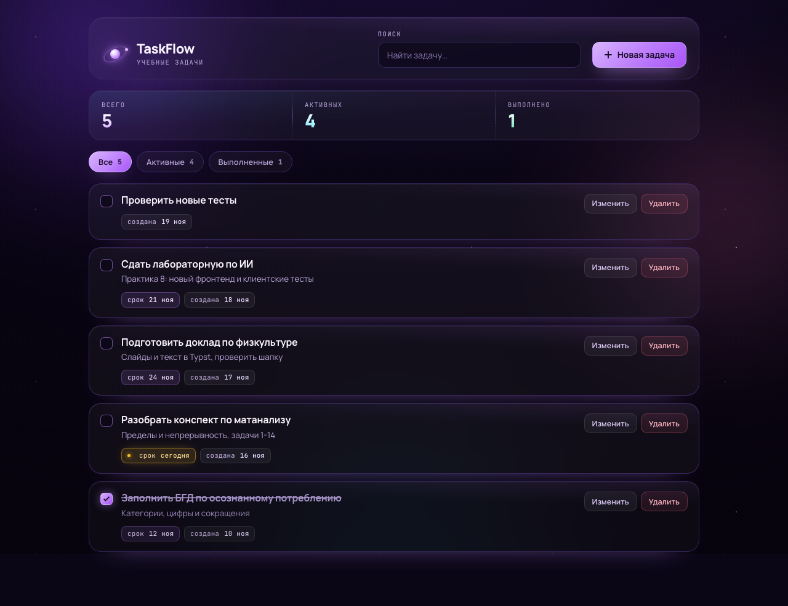
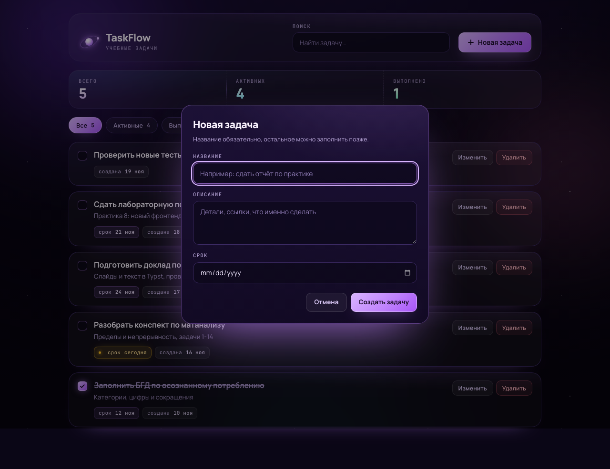
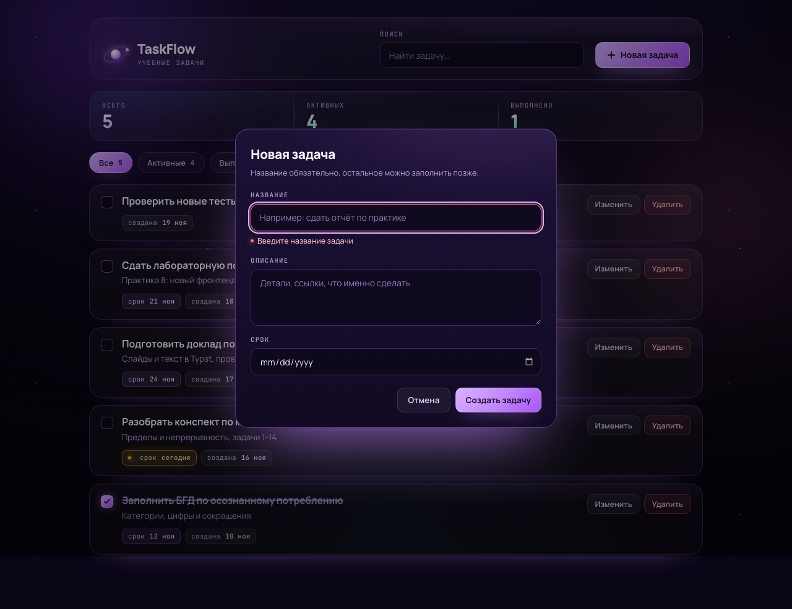
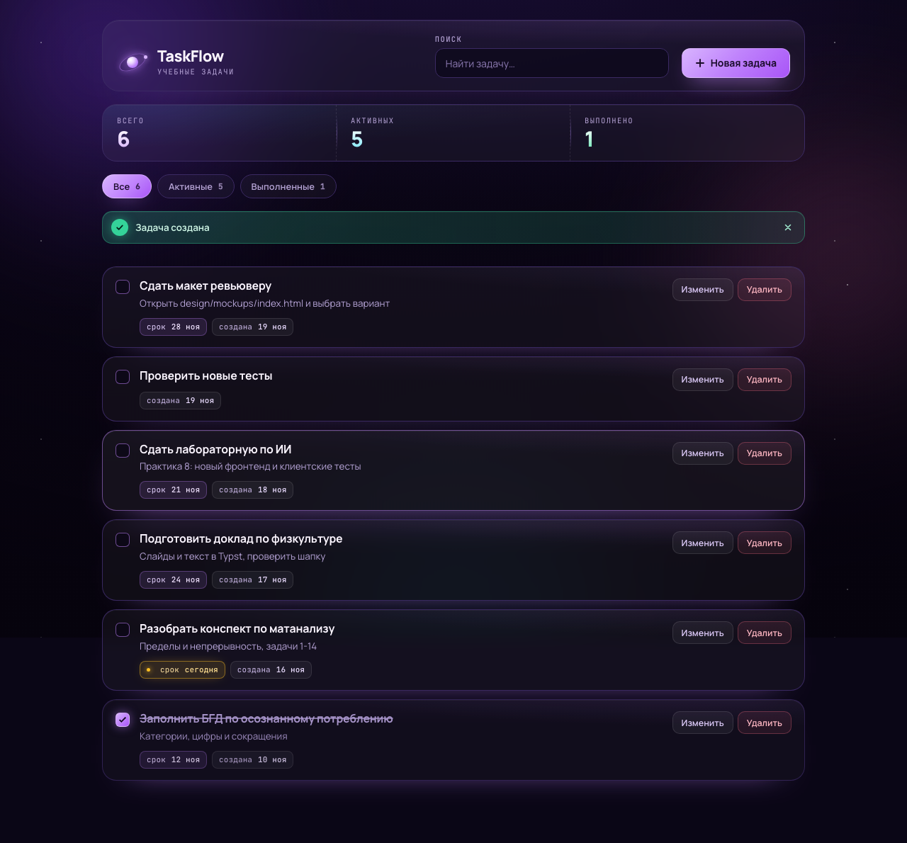
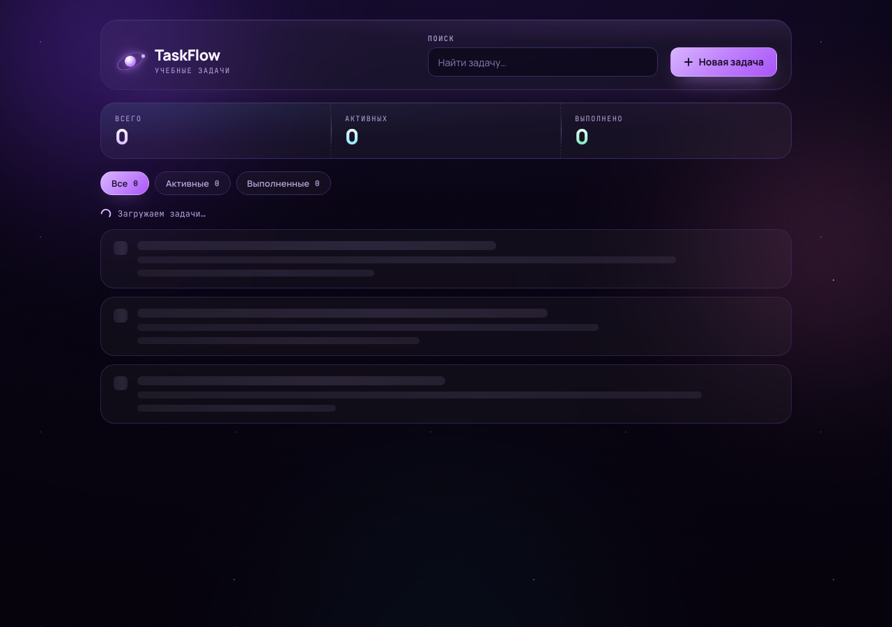
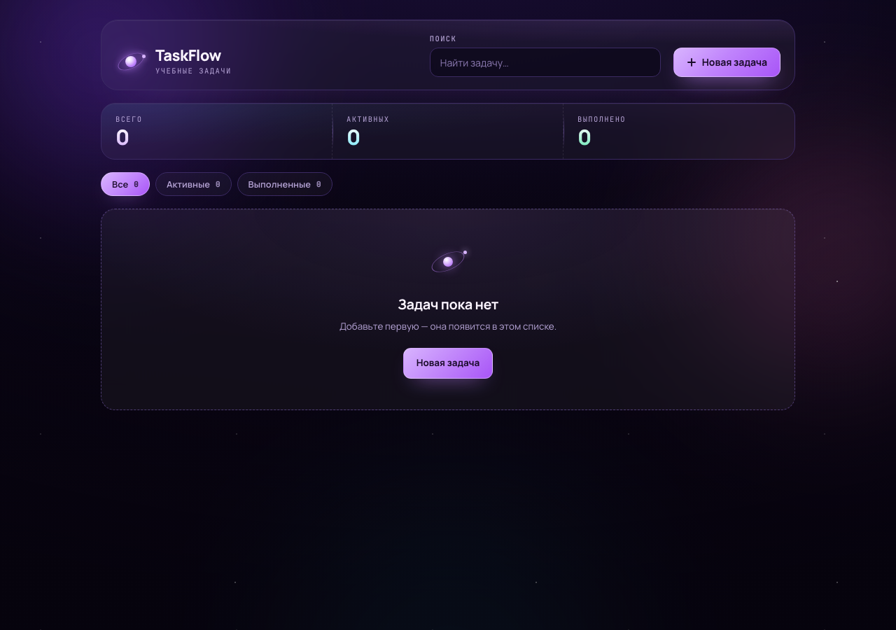
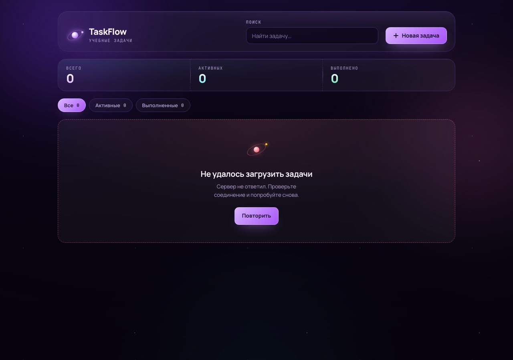
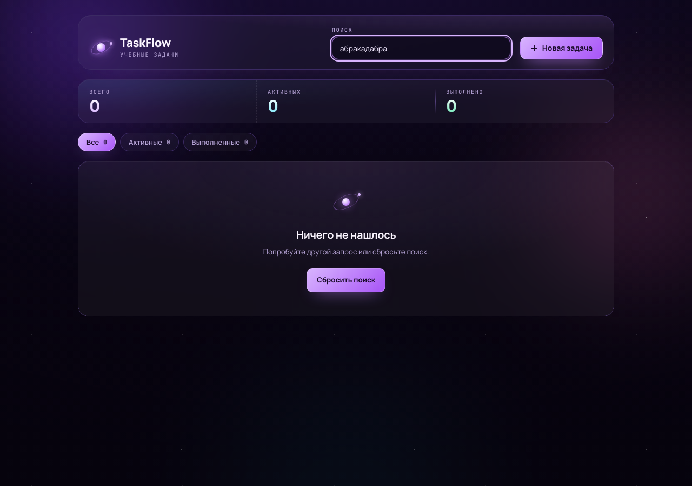
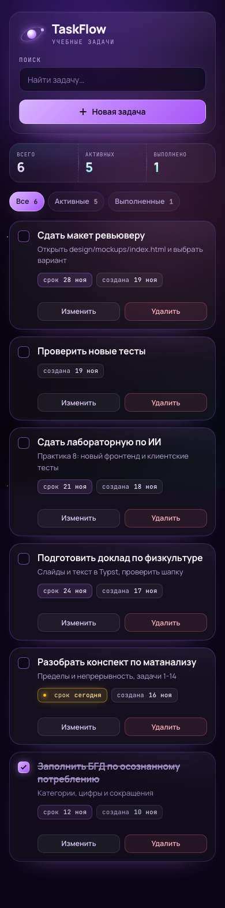

# Практика 8 — отчёт

## Что сделано

У учебного проекта TaskFlow (Express + SQLite + SPA на ванильном JS) полностью заменён
фронтенд: русский интерфейс в тёмной космической теме на дизайн-системе DaisyUI 5,
модальные диалоги создания/редактирования/удаления, состояния загрузки, пустоты,
ошибки и успеха, поиск и фильтры. Добавлены клиентские тесты на Playwright, которые
проверяют поведение интерфейса, а не наличие элементов в коде.

Бэкенд не менялся: все действия идут в существующие `GET/POST/PUT/DELETE /api/tasks`.

## Сценарий

Пользователь — студент, который ведёт учебные задачи. Основной сценарий:

1. открывает страницу и видит список задач (или «Задач пока нет»);
2. нажимает «Новая задача» — открывается диалог, фокус в поле «Название»;
3. вводит название, описание и срок, отправляет;
4. видит новую карточку первой в списке и уведомление «Задача создана»;
5. отмечает задачу выполненной — карточка зачёркивается, счётчики меняются;
6. при необходимости меняет или удаляет задачу через диалоги.

Подробно — `docs/01-scenario.md`, включая таблицу восьми состояний и критерии приёмки.

## Макет и библиотека

Сделано пять интерактивных HTML-прототипов с одинаковым содержимым и разными
библиотеками: Shoelace, DaisyUI, Bootstrap, Pico, Beer CSS. Галерея —
`design/mockups/index.html`. Выбран **DaisyUI 5** («Туманность»): тёмная тема,
фиолетово-розовая туманность, мягкие стеклянные карточки, крупные скругления.

Макет — не картинка: панель «МАКЕТ» переключает список, загрузку, пустое состояние,
ошибку и диалог. По замечанию заказчика активный пункт панели сделан фиолетовым,
а не циановым; счётчики приведены в соответствие с четырьмя задачами.



Подробно о вариантах, токенах и отличиях макета от реализации — `docs/02-design.md`.

## Интерфейс

Файлы:

- `public/index.html` — разметка: шапка, сводка, фильтры, четыре состояния, два диалога;
- `public/styles/app.css` — палитра, типографика, отступы, туманность, состояния,
  адаптив; компоненты DaisyUI (`.btn`, `.input`, `.card`, `.badge`, `.modal`,
  `.alert`, `.loading`, `.checkbox`);
- `public/js/api.js` — `api(path, opts)`: JSON, таймаут-ошибки, разбор `{error}`;
- `public/js/app.js` — состояние, полный перерендер списка, диалоги, поиск, фильтры.

Что важно для требований:

- **Повторная отправка.** Флаг `state.submitting` ставится до `await`; кнопка получает
  `disabled` и `aria-busy`, поля блокируются, обработчик `submit` выходит сразу, если
  запрос уже идёт. Двойной клик и повторный Enter дают ровно один `POST`.
- **Валидация.** Пустое или пробельное название не уходит на сервер: под полем
  появляется «Введите название задачи», у поля `aria-invalid`, фокус возвращается в него.
- **Ошибка сервера.** В диалоге показывается сообщение, введённые данные сохраняются,
  кнопка снова активна — можно повторить. При загрузке списка — отдельный экран
  с кнопкой «Повторить».
- **Доступность.** У всех полей `<label for>`, у диалогов `aria-labelledby`,
  у чекбоксов и кнопок понятные `aria-label`, фокус виден (`:focus-visible`, 2 px),
  Esc закрывает диалог, фокус возвращается на кнопку-инициатор, Enter работает.
- **Адаптив.** На 390 px карточки в одну колонку, действия не прячутся, диалог занимает
  почти всю ширину, горизонтальной прокрутки нет.

## Тесты

`npm test` = 25 серверных тестов (`node:test`) + 17 клиентских (Playwright), все зелёные.
Клиентские тесты подменяют API через `page.route` ответами в формате настоящего сервера:
успех, пустой список, задержка, 500, 404. Один тест работает с настоящим API и проверяет
создание, выполнение, сохранение после перезагрузки и удаление.

```
Running 17 tests using 1 worker
...
17 passed (21.8s)
```

Проверка качества: временно убрали показ сообщения об ошибке создания — тест упал;
вернули код — снова зелёный. Подробный список тестов и их привязка к критериям —
`docs/03-testing.md`.

## Скриншоты

Список с данными (настоящий API):



Создание задачи:



Валидация пустого названия:



Успешное создание и уведомление:



Загрузка (скелетоны):



Пустой список:



Ошибка загрузки:



Поиск без результатов:



Узкий экран 390 px:



## Как запустить и показать

```bash
npm install
npm start                 # http://localhost:3000
npm test                  # серверные + клиентские тесты
npm run test:client       # только Playwright
```

Макеты: `python3 -m http.server 3100 --directory design/mockups`, затем
`http://127.0.0.1:3100/` (в текущей сессии сервер уже поднят).

Демонстрация: открыть список → создать задачу → увидеть её первой → отметить
выполненной → обновить страницу (состояние сохранилось) → удалить через подтверждение.
Отдельно показать пустую базу, остановленный сервер (ошибка + «Повторить») и узкий экран.

## Использование AI

Инструменты: Hermes Agent, сабагенты для пяти макетов и описания сценария, Playwright
для проверки. Примеры запросов, что AI предложил и что пришлось исправить —
`docs/04-ai-log.md`. Кратко: AI сгенерировал прототипы и первую версию кода; проверка
скриншотами и тестами нашла гигантский чекбокс в одном макете, светлые карточки
в другом, несовпадение счётчиков, отсутствующие `data-testid`, гонку возврата фокуса
и остатки старых карточек в скрытом списке. Всё перечисленное исправлено.

## Что подготовлено для сдачи

- Исходный код: каталог `practices/practice_08` репозитория ITMOv2 (ветка `homework_08`).
- `README.md` — установка, запуск, тесты, название библиотеки, структура.
- Макет: `design/mockups/index.html` и `design/mockups/variant-2-tumannost.html`.
- Скриншоты всех состояний: `docs/screenshots/`.
- Результат тестов: `17 passed` (клиентские), `25 passed` (серверные).
- Отчёт и вспомогательные документы: `docs/`.

## Ограничения

- DaisyUI и шрифты подключаются с CDN; без сети интерфейс останется работоспособным,
  но потеряет часть оформления. Для офлайн-проверки можно положить CSS в `public/`.
- Формат даты в поле «Срок» рисует браузер; в русской локали он может выглядеть
  как `дд.мм.гггг`, в английской — `mm/dd/yyyy`. Значение всё равно уходит как
  `YYYY-MM-DD`.
- Авторизации, нескольких списков и совместной работы нет — это вне сценария.
